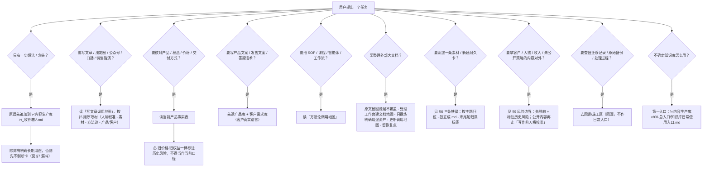

# 个人知识库取材导航器（personal-kb-navigator）

个人 AI 知识库是**面向 AI 调用的检索式知识库**：不要求人按文件夹逐层翻找，而是由 AI 按当前任务从各库「调用地图 / 总入口」取材、处理，并把结果回填到正确位置。本技能把这类库的结构、沉淀规则、取材路线与风险边界封装为可直接执行的判断逻辑，适用于任何采用「根说明 + 主题库 + 回源/施工区」结构的个人知识库。

## 1. 前置：定位知识库根目录（`KB_ROOT`）

| 变量 | 取值来源（按顺序尝试） | 说明 |
|---|---|---|
| `KB_ROOT` | ① 用户本次给定 → ② 环境变量 `PERSONAL_KB_ROOT` → ③ 向用户询问 | 知识库根目录。**取值随环境变化**（迁移 / 改名 / 换机），每次使用前必须先检测；检测失败就向用户要实际路径，不要猜测、不要沿用旧值。 |

```powershell
# 检测（-LiteralPath 可正确处理中文路径）
Test-Path -LiteralPath "<KB_ROOT>\AGENTS.md"
```

> **为什么 `KB_ROOT` 做成三级解析而不是写死常量？** 路径是环境相关值，硬编码会在迁移后**静默失效**——AI 会以为取材成功却读到了错误位置，静默失效比报错更危险。因此不预置任何默认路径：先向用户要，再退到环境变量，最后才询问，每一步都用 `Test-Path` 显式验证。

`<KB_ROOT>\AGENTS.md` 是根目录唯一说明，也是该库处理规则的自述文件。**开始任何取材或写入前先读它**——它比本技能更新，冲突时以它为准。

## 2. 何时使用 / 何时不用

**使用**：目标知识库确为「根说明 + 主题库 + 回源区」结构，且用户要做取材、写作、核对、整理、沉淀动作——包括只用一句口语（如「帮我把这个想法存起来」「我要写篇公众号，你帮我找素材」）。

**不用**：与个人知识库无关的任务（通用代码开发、公开网页研究、他人的团队 wiki）不要套用本技能的取材与沉淀规则。

> **为什么对口语也触发？** 这类库的设计前提是「日常只做一件事——自然记录，整理交给 AI」。等用户说出「调用地图」这类术语才触发，就违背了它的使用方式。

## 3. 核心模型速览

### 3.1 通用结构

```
<KB_ROOT>\AGENTS.md          ← 唯一根说明（规则权威）
├─ <主题库 1..N>            ← 前台可调用区：正式卡 / 主题目录 / 当前入口 / 索引卡
└─ <回源/施工区>            ← 原始备份、旧索引、处理工作台、暂不确定归属的散件
```

### 3.2 两层结构

- **前台可调用区（核心库）**：放正式卡、主题目录、当前入口、整理后的索引卡和可直接使用的资产。
- **回源层 / 施工区**：回源核对原始材料之处，**不是**日常检索入口。

两层分离的关键是**原文永不覆盖**：原话与外部记录原文留在回源层，AI 整理稿与之分开保存。

> **为什么根目录要极简？** 极简根目录的目的不是整齐，而是**让调用可预测**——AI 每次都能用同样几个入口定位素材。文件一旦散落根目录，取材就从「查入口」退化成「碰运气」。同理，回源/施工区只做施工与回源：如果它也堆满日常资产，就会和前台区抢入口。

### 3.3 示例实例（七库一说明）

| 库 | 装什么 |
|---|---|
| `1-老板说明书` | 我是谁、我的故事、表达风格、边界和判断 |
| `2-产品库` | 产品体系、权益、价格证据、发售历史、销售素材 |
| `3-客户需求库` | 客户原话、需求线索、反馈、未成交原因、咨询材料 |
| `4-素材案例库` | 朋友圈素材、个人故事、生活现场、客户案例、可调用证据 |
| `5-方法论库` | 内容创作、AI 工作流、产品设计、营销销售、咨询交付、团队 SOP |
| `6-内容生产` | 选题、成稿、文章索引、对标账号、生产流水线 |
| `7-其他备用` | 回源/施工区：原始备份、旧索引、处理工作台、输出产物、暂不确定归属的散件 |

库名仅为示例；套用到其他库时，以该库 `<KB_ROOT>\AGENTS.md` 的实际结构为准。

## 4. 取材决策树



## 5. 按任务取材路线速查

| 任务 | 取材起点（按顺序） |
|---|---|
| 写个人故事 / 朋友圈 / 销售页人物背书 | 老板说明书 → 素材案例库 |
| 写产品文案 / 发售文案 / 答疑话术 | 产品库 → 客户需求库 |
| 写公众号 / 口播 / 复盘 | 内容生产 → 回到 老板说明书 + 素材案例库 取故事 |
| 搭 SOP / 课程 / 智能体 / 工作流 | 方法论库 |
| 查旧迁移 / 原始备份 / 处理过程 | 回源/施工区 |
| 临时新增文章 / 草稿 / 链接 | 先入 `_收件箱`，处理后再分流 |

**写文章的完整取材顺序**：先在调用地图确定任务类型 → 老板说明书校准人物与表达 → 素材案例库找故事与证据 → 方法论库找方法论 → 产品库 与 客户需求库 校验产品和用户。

写文章/朋友圈前，先问清四件事：**写给谁 / 解决什么问题 / 想表达什么 / 发到哪里**。

## 6. 沉淀规则：三条铁律

1. **按主题分子文件夹，不按来源分** —— 决定素材放哪的是「它讲什么主题」，不是「它从哪来」。
2. **每条素材独立成 md，末尾加基础标签** —— 一条素材对应一个文件。
3. **每次入库都必须标注资产归属** —— 回答「这是谁的、从哪来、将来在哪用」。

**归属标签模板（二选一）**：

```
🧭 归属：自有产出 / 与我相关
📌 来源：……
🎯 应用：……
```

```
🧭 归属：外部学习 / 他人资料
📌 来源：……
🎯 应用：……
```

- **自有产出**：我写的 / 我说的 / 我做过的，以及我的产品、客户、学员、团队、朋友圈、公众号、咨询、复盘、聊天记录。
- **外部学习**：书、课程、文章、对标账号、公开案例、行业资料、他人方法论。
- **混合材料只选一个主归属**；仅当低置信度、可能影响关键分类或改变后续调用方式时，才向用户确认。

> **为什么不按来源分文件夹？** 按「公众号来的」「某个工具来的」分，同一主题的证据会散在多处，取材时就得跨目录拼凑，调用从一次定位变成多次检索。按主题分，是让「素材跟着用途走」。

## 7. 收件箱 → 分流漏斗

```
自然记录 → 原话进收件箱 → AI 判断「是否已有明确用途？」 → 有用途才提炼为耐久卡 → 分流进对应核心库
```

- 对话原话先追加到 `<内容生产库>\_收件箱\` 下的收件箱文件，再判断是否值得提炼入库。
- 临时新增的文章、草稿、链接同步内容也先入 `_收件箱`，处理后再分流。
- 允许**先不制卡**：没有明确长期用途的念头，保留原话即可。

**AI 整理时必须遵守**：先保存原话再保存整理稿；不覆盖外部原文；按未来用途分类，不按来源机械搬运；只建立有明确应用的耐久卡；AI 生成内容与用户原话分开；旧产品信息标注历史风险；人物/咨询/客户内容先脱敏；整理结束更新入口与唯一总控；**新资产必须让调用更方便，而不是让文件更多**。

> **为什么允许「先不制卡」？** 知识管理的常见失败模式是「每天整理」把使用者拖垮。本类库的前提是「不增加使用者负担」——整理成本转移到按需的 AI 处理上。强行给每条念头制卡，会让库变大而调用变难，得不偿失。

## 8. 安全检查清单：写入 / 整理（逐项确认）

对知识库做任何写操作（新建、追加、移动、改写、分流）前逐项确认：

- [ ] 已读 `<KB_ROOT>\AGENTS.md`（它是规则权威，优先级高于本技能）
- [ ] **不覆盖原文**：原话 / 外部记录原文保留在回源层，整理稿另存（严禁用整理稿覆盖原话）
- [ ] 新增文件的位置符合「按主题分类」，而非按来源堆放
- [ ] 新素材末尾已加**归属标签**（🧭 归属 / 📌 来源 / 🎯 应用）
- [ ] 混合材料只选了一个主归属
- [ ] 旧价格 / 旧权益 / 旧发售节奏已标注**历史资料或过时风险**
- [ ] 涉及客户、私教、聊天、人名、收入、未公开策略的内容**已脱敏**（对外使用前）
- [ ] AI 生成内容与用户原话**分开存放**
- [ ] 整理结束已更新对应入口 / 调用地图（让调用更方便，而不是文件更多）
- [ ] 写操作前向用户展示将要改动的位置与内容（**预览/diff**），获得明确确认
- [ ] **幂等性检查**：追加前先查目标文件是否已存在同一素材 / 同一段落，避免重复写入或意外覆盖
- [ ] 操作完成后**验证结果**：重新读取目标文件，确认新内容确实落在预期位置（不假设成功）
- [ ] 阶段性产物统一进回源/施工区的处理工作台，不长期堆在根目录或核心库前台

> **为什么「不覆盖原文」是不可协商的第一条？** 覆盖是不可逆的：一旦整理稿替换了原话，就永久失去了回源核对的能力，而 AI 整理稿可能有误读。保留原文 + 另存整理稿，等于给每次整理留了「撤销点」。这也是把回源/施工区独立出来的根本原因。

## 9. 风险边界

- **历史资料**：旧价格、旧权益、旧发售节奏一律标注历史资料/过时风险，避免被当作当前有效口径。
- **脱敏**：客户、私教、聊天、人名、收入、未公开策略，对外使用前必须脱敏。
- **判断边界**（反向护栏示例）：《AI 可以辅助整理，但不能替我体验和判断》《可能性清单不等于现实承诺》《个人健康记录不等于医疗建议》——AI 只提供候选，不可替代本人的判断与体验。
- **身份称呼**：资料中出现的作者别名 / 缩写，均视为知识库所有者本人；主要称呼以 `<KB_ROOT>\AGENTS.md` 记载为准。
- **写作前人格校准**：代写 / 改写 / 整理公开内容前，先走人物校准清单的 7 项检查（身份锚点 / 真实经历证据 / 强判断 / 是否夸大或承诺 / 适合哪个渠道 / AI 候选 vs 已确认判断 / 有无用流畅 AI 表达替代本人体验）。

## 10. 外部记录工具与本地库的临时分工

| 载体 | 角色 |
|---|---|
| 外部记录工具（如笔记 / 大纲类应用） | 使用者熟悉的阅读、思考和持续记录空间 |
| 本地知识库 | AI 的处理、检索、去重、风险校验和资产调用空间 |
| 对话收件箱 | 保存当前任务中输入的原话 |
| 原文备份 | 用于回源，不作日常阅读入口 |

这是**临时分工**，不代表已决定本地或外部工具谁是永久唯一主库。当前阶段优先验证「不增加使用负担」的最小工作流；数据流跑通前，不继续扩张大库和卡片体系。

## 11. Gotchas（陷阱与反直觉行为）

- **术语即入口，但入口不止术语**：`写文章调用地图`、`素材调用地图` 等是**目标知识库里的真实文件路径**，不是本技能内部文件；拼路径前先确认存在。
- **「地图」计数别硬编**：承担导航职责的文件不止「地图」一类（还有各库「总入口」与「当前产品事实表」）。描述数量时用「各库调用地图与总入口」，避免把事实表误计为地图。
- **旧资料 ≠ 当前口径**：产品事实表文件名含「待补」说明它本身可能未补全；旧价格 / 权益必须回查并标注，不能直接当现售价写进文案。
- **回源区不是检索区**：能在核心库找到的资产，不要图省事去回源区取「看起来更新」的散件。
- **提交历史风险**：引用旧文章时区分「已发布且有链接 / 已写但未发布 / 只有题目或半成品」三种状态，不要混用。

## 12. 参考文档（按需加载）

> 路径基准说明：`[x.md](references/…)` 相对**本技能目录**；`<KB_ROOT>\…` 相对**目标知识库根目录**。

| 文档 | 何时读 |
|---|---|
| [model-and-routing.md](references/model-and-routing.md) | 需要各调用地图的**读取时机**、各库职能细表与示例实例导航层时 |
| [sedimentation-and-risk.md](references/sedimentation-and-risk.md) | 需要归属判定细则、整理原则全文、风险边界与人格校准清单时 |
| `<KB_ROOT>\AGENTS.md` | **任何取材 / 写入前**——规则权威，优先于本技能 |

## 13. Changelog

- **v1.0.0**（2026-10-13）：初始版本。由一份个人知识库治理实践（根说明 + 七库 + 回源区）通用化萃取，覆盖取材决策树、三条沉淀铁律、收件箱漏斗与写入安全清单。
