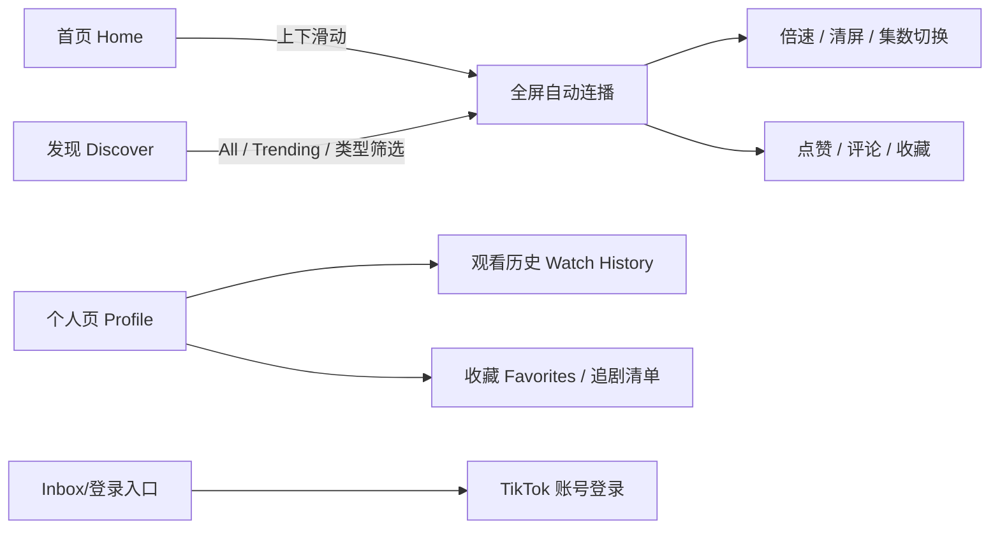

# PineDrama 产品形态与功能

PineDrama 的产品形态可以概括为"**TikTok 的交互外壳 + 红果的内容组织 + 本土化自制供给**"。本篇按内容形态、界面结构、账号体系、免费策略变化四部分拆解。

## 1 内容形态

| 维度 | 形态 |
|---|---|
| 单集时长 | 约 1–3 分钟 |
| 画幅 | 竖屏全屏，单手操作 |
| 单部体量 | 微短剧长集数连续结构（TikTok × 圣丹斯编剧课程材料以 60 集体量为教学结构，S-16） |
| 核心题材 | romance（言情）、revenge（复仇）、CEO（霸总）、family（家庭）、thriller（悬疑惊悚）；以女频强情绪叙事为主 |
| 代表作 | *Love at First Bite*、*The Officer Fell for Me*（均为 Business Insider/Digital Trends 列举的热门标题；另有行业综述称前者播放超 1800 万，`[SINGLE-SOURCE]`）；与 HOORAE 合作的《Screen Time》首周近 7500 万播放、后破 1.5 亿；中国香港团队制作的《10亿奈拉新娘》（尼日利亚背景）上线一周破 4000 万播放 `[SINGLE-SOURCE]` |
| 供给策略 | 主打海外本土原创、"拒绝译制剧"；第三方下载站称首批上架 51 部并持续更新 |
| 多语言 | 多语言字幕 + 专业配音；下载站口径 52 种语言，另有媒体称 40+ 语言含韩语配音——**两口径并列，不取中值** |

题材选择与国内红果、短剧行业的女频基本盘一致，但故事背景、角色族裔、场景均做了本地化（如尼日利亚背景的《10亿奈拉新娘》）。这一"爽剧叙事内核 + 本地文化设定"的配方是其与 Melolo 时代"译制剧"路线的关键区别，见 [失败前科](07-failed-predecessors.md)。

## 2 界面与交互结构

- **首页（Home）**：推荐流，点封面直接进全屏播放。
- **发现（Discover）**：Business Insider 描述的核心找剧入口——竖滑推荐之外，支持按 All/Trending 与题材类型筛选。
- **播放页**：上下滑切换剧集、自动连播；支持倍速、全屏、清屏、集数切换、断点续播；右侧有点赞、评论、收藏、作者头像（点头像可进入该剧方主页看其他作品）。
- **个人页（Profile）**：观看历史、收藏、追剧清单。
- **评论区**：剧名称与简介、评论均以英文等当地语言展示（中文下载站观察到界面有少量中文残留）。

交互层面几乎完整继承 TikTok 的肌肉记忆：用户不需要学习新手势，这对转化率（下载→观看→留存）的价值无法直接量化，但 Digital Trends 与多家下载站都把"刷剧流畅如 TikTok"列为首要体验点。

## 3 账号体系与 TikTok 生态互通

- 支持以 TikTok 账号一键登录（Log in with TikTok），观看数据同步；没有 TikTok 账号的用户需注册。
- 账号互通是双轨漏斗的技术前提：TikTok 主端 Minis/Short Dramas 入口的试看用户可零摩擦迁移到独立 App，反之独立 App 的互动内容（切片、讨论）也可回流主端。
- 广告与投放体系打通：2026-06 推出的 TikTok Growth Max for Mini Dramas 让短剧买量与转化在同一广告系统内闭环。

双轨结构详见 [字节战略：红果复刻与双轨漏斗](06-bytedance-strategy.md)。

## 4 免费策略：从"完全无广告"到 IAA 变现

产品文案与媒体报道呈现出清晰的两阶段：

| 阶段 | 时间 | 策略 |
|---|---|---|
| 冷启动 | 2026-01 上线起 | 免费；无开屏、无插播、无贴片；不充会员、不付费解锁。TechCrunch 原话"不像 DramaBox 那样塞满广告，至少目前如此" |
| 变现引入 | 2026 年内逐步 | 集间广告（剧集切换之间）与信息流广告位逐步上线；仍免费看剧 |

这与红果在国内的路径一致：先用纯净体验与免费供给把时长盘子做大，再在推荐流中提高广告密度。其商业逻辑（免费供给扩时长 → 推荐提密度 → 广告回收）见 [免费 IAA 商业模式](03-iaa-business-model.md)。

## 5 与对照产品的形态差异

| 维度 | PineDrama | ReelShort/DramaBox | 国内红果 | B 站短剧（下载站对比口径，仅参考） |
|---|---|---|---|---|
| 付费 | 免费 + 广告（后期） | 前几集免费，后续按集内购/充值 | 免费 + 广告 | 会员/超前点播 |
| 内容 | 海外本土原创为主 | 自制+采购，大量华裔团队制作的美式爽剧 | 番茄 IP 改编 + 采购，国内团队 | 年轻向精品国产短剧 |
| 交互 | TikTok 式竖滑 | 竖滑但付费墙打断 | 抖音式竖滑 | B 站社区生态 |
| 生态 | TikTok 账号/广告体系打通 | 独立 App + 投流 | 抖音/番茄闭环 | B 站 UGC 社区 |

> 表中 B 站一列来自中文下载站营销文案，仅作形态对照，不作为竞争格局结论依据；收入与市场份额对比请看 [竞争格局与行业剪刀差](05-competitive-landscape.md)。

## 相关概念

- [PineDrama 产品概览](00-overview.md)
- [免费 IAA 商业模式](03-iaa-business-model.md)
- [字节战略：红果复刻与双轨漏斗](06-bytedance-strategy.md)
