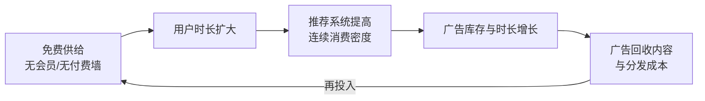

# PineDrama 免费 IAA 商业模式

PineDrama 最核心的商业选择是 **IAA（In-App Advertising，应用内广告）免费模式**，而不是 ReelShort、DramaBox 赖以起家的 **IAP（In-App Purchase，按集内购）模式**。这一选择不是定价策略差异，而是对"向谁收钱、卖什么东西"的重新定义。

## 1 三段机制

行业媒体（澎湃·短剧深水区）将其机制拆成三段，对应国内红果已验证的内容平台飞轮：

1. **免费供给扩大用户时长**：不充会员、不付费解锁，降低新兴市场用户的进入门槛；上线初期甚至无广告，先培养刷剧习惯。
2. **推荐系统提高连续消费密度**：竖滑自动连播 + 算法推荐，把"看完一部"变成"一部接一部"，单用户单日观看时长是 IAA 的库存单位。
3. **广告回收成本**：集间广告与信息流广告在用户习惯养成后逐步引入；广告负载与 eCPM 决定单用户广告收入（ARPMA）。

红果在国内把同一飞轮跑通：其免费模式份额从 2024 年 1 月的约 11% 升至 2024 年 10 月的约 50%（行业稿口径），人均单日使用时长达到 125 分钟（2026-06 口径）。

## 2 IAA vs IAP：两种生意的对照

| 维度 | IAA（PineDrama / 红果） | IAP（ReelShort / DramaBox） |
|---|---|---|
| 用户付费 | 不付费，用注意力换内容 | 前几集免费，后续按集/按币充值 |
| 收入公式 | 用户时长 × 广告负载 × eCPM | 付费率 × ARPPU × 用户规模 |
| 适配用户 | 支付基础设施弱、付费习惯弱的新兴市场用户 | 美/日/韩/英/澳等高付费市场用户 |
| 关键能力 | 推荐算法、广告系统、低成本/规模化内容供给 | 投流买量、单剧 ROI 测算、付费点设计 |
| 现金流特征 | 起量慢、回收依赖广告大盘；规模效应强 | 单部剧可快速回本；头部剧收入集中 |
| 内容消费形态 | 连播刷剧，广告打断 | 付费墙卡在钩子集，情绪峰值变现 |

DataEye 2026 年 8 月监测显示两组市场几乎不重叠：收入最高的美/日/韩/英/澳拿走全球约一半流水（美国约占近三成），而下载前三的印度（13.8%）、印尼（12.9%）、巴西（10.4%）合计贡献全球近四成下载。PineDrama 选择的正是后者——详见 [区域市场：印尼与巴西](04-regional-markets.md)。

## 3 行业背景：从"卖集数"到"卖时长"

- Owl &Co. 调研：免费广告支持的短剧应用占用全球短剧用户总时长的比例，从 **2025Q1 的 15% 升至 2026Q2 的 83%**（经澎湃、电影界转引）。
- Sensor Tower：2026Q1 全球短剧应用下载超 8.5 亿次（同比约 +140%），但同期内购收入仅约 7.5 亿美元（同比约 +20%）。

这组"剪刀差"说明新增用户主要被免费模式承接。但要注意两个统计限定：①8.5 亿下载是全品类短剧 App（含 IAA 与 IAP 产品）；②7.5 亿美元仅为商店**内购**收入，不含广告收入，因此不能据此说"行业总收入减速"——准确的说法是"**新增时长正在向广告模式迁移，内购模式的增长相对放缓**"。竞争格局全貌见 [竞争格局与行业剪刀差](05-competitive-landscape.md)。

## 4 商业化动作与已知信号

- **广告产品**：2026-06 推出 TikTok Growth Max for Mini Dramas，短剧买量与广告变现接入 TikTok 广告体系。
- **版权分账**：有行业综述称 TikTok 2026Q1 向短剧版权方分账超 2400 万美元（`[SINGLE-SOURCE]`，按 65–70% 分成比反推 GMV 约 3400–3700 万美元；TikTok 未官方确认，分账来自主端 Minis 还是 PineDrama 也未区分）。
- **收入数据缺口**：截至 2026-10，**没有任何公开来源给出 PineDrama 的广告收入、ARPU/eCPM 或盈亏数据**。媒体对其商业化的评价（电影界："规模易得，盈利难证"）应视为判断而非事实。

## 5 免费模式成立的三个前提（从红果与 PineDrama 共同观察）

1. **足够低的内容边际成本**：需要规模化、可快速本地化复制的爽剧供给，单部成本必须低于其生命周期广告回收。红果依托番茄小说 IP 池解决素材源头；PineDrama 海外侧靠自制选角、HOORAE/圣丹斯合作与区域团队补位，成本曲线未公开。
2. **足够强的推荐与广告系统**：字节将抖音/TikTok 的推荐与广告中台复用至短剧场景，这是独立短剧创业公司最难复制的资产。
3. **支付摩擦高、免费替代品教育成熟的用户市场**：印尼用户已被 Vidio 等本土免费广告视频平台教育，降价到 0.2 美元/集仍无法拉动付费（从业者访谈，`[SINGLE-SOURCE]`）——需求真实存在，但付费通道不存在，广告是唯一可规模化的回收方式。

## 相关概念

- [产品形态与功能](02-product-features.md)
- [区域市场：印尼与巴西](04-regional-markets.md)
- [竞争格局与行业剪刀差](05-competitive-landscape.md)
- [字节战略：红果复刻与双轨漏斗](06-bytedance-strategy.md)
