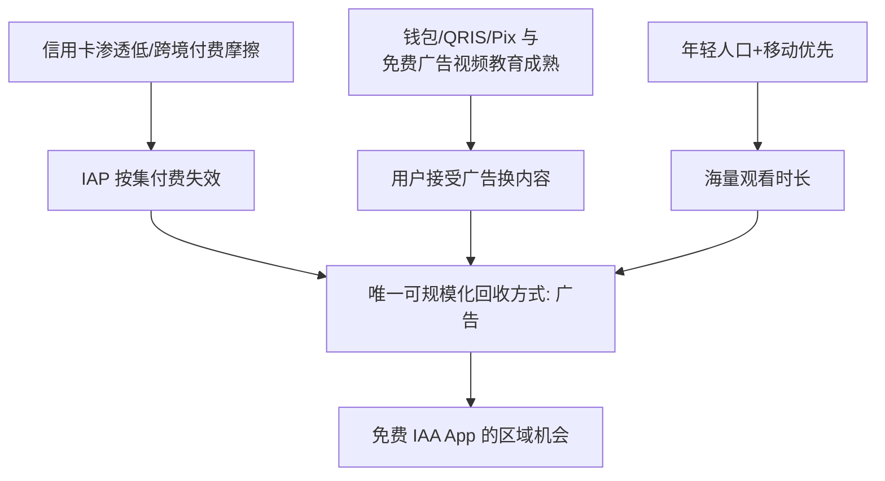

# PineDrama 区域市场：印尼与巴西为何贡献 82% 下载

Sensor Tower 口径，PineDrama 超过八成累计下载集中在印度尼西亚与巴西——一个是东南亚最大的穆斯林国家（雇员月均收入不足 200 美元），一个是拉美最大的葡语国家（人均 GDP 过万美元）。两国收入水平几乎没有共同点，却被同一款免费短剧应用同时选中。本篇的核心论点：**决定 IAA 模式落点的不是人均收入，而是支付结构与免费内容消费习惯**。

## 1 82% 的位置

| 事实 | 数值 | 口径 |
|---|---|---|
| 印尼+巴西占 PineDrama 累计下载 | 82% | Sensor Tower，2026-09 报道 |
| 印尼占全球短剧下载（全行业） | 12.9% | DataEye，2026-08 |
| 巴西占全球短剧下载（全行业） | 10.4% | DataEye，2026-08 |
| 印尼单月短剧下载 | 5500 万次，占全球 22% | DataEye，2026-04（当月印尼一度是全球短剧下载第一大单一国家） |
| 印尼同月短剧内购收入 | 仅 400 万美元 | DataEye，2026-04 |

5500 万下载对 400 万美元内购——这是"留得住、付不起费"市场最直观的量化注脚。

## 2 印尼：被支付习惯逼出来的免费模型

**人口与需求侧**（DataReportal《Digital 2026》）：总人口约 2.84 亿，中位年龄 30.4 岁，雇员月均收入不足 200 美元；年轻、移动端优先、娱乐时长充裕。

**支付结构**（支付行业数据，经澎湃转引）：

- 信用卡持卡人约 1400 万，仅占总人口 **5%–7%**，跨境绑卡付费摩擦极高；
- 但数字支付并不落后——印尼跳过信用卡阶段直接进入钱包/二维码时代：国家二维码标准 **QRIS 用户 5800 万**，GoPay、ShopeePay、DANA、OVO 四大电子钱包月活合计约 **1.48 亿**；超过八成手机使用预付费 SIM 卡。

这套体系天然适配小额、碎片化、用钱包余额或话费完成的交易，却与"绑定信用卡按集扣 0.99 美元"的传统 IAP 逻辑格格不入——加之应用商店支付通道本身的摩擦，大量用户根本无法完成第一笔内购。

**消费习惯**：印尼用户已被 Vidio 等本土"免费 + 广告"视频平台长期教育。行业数据显示印尼短剧应用收入结构中**广告约占 72%、内购约 28%**；有从业者把单集价格从 1 美元降到 0.2 美元，付费率几乎没有变化（`[SINGLE-SOURCE]` 访谈）——说明瓶颈不是价格，而是付费通道与付费意愿双重缺失。

## 3 巴西：高收入国家为何也落在免费侧

巴西人均 GDP 过万美元，收入水平远高于印尼，但两个结构性因素使其同样偏向免费模式：

1. **信用卡≠可跨境订阅**：巴西信用卡分期（parcelamento）文化盛行，持卡人对跨境小额连续扣费的接受度低；历史上高利率环境使循环信用谨慎。
2. **Pix 重塑了支付预期**：巴西央行 2020 年推出的即时支付系统 Pix 已高度普及，巴西人习惯了免费、即时、直达的付款体验——应用商店内购的汇率、税费与步骤反而显得笨重。

同时，拉美用户的短剧留存反而是全球最高一档：《Short Drama Apps Report 2026》显示 2026Q1 拉美短剧用户次日留存 20%、30 日留存 4%，高于全球 15%/2% 的基准；但拉美月活用户月均收入（ARPMA）仅约 0.68 美元（低于 2025 年的 0.71 美元），显著低于北美的 1.29 美元与亚太的 1.45 美元。**粘性最高的用户，偏偏是钱包最薄（或最不愿为内容付费）的用户**。

## 4 为什么 IAA 在这里能成立

广告模式绕开了两个支付问题：用户不需要绑卡，广告主在本地货币与本地广告系统内结算（字节可复用 TikTok 全球广告网络与 Growth Max 投放工具）。对用户是"看广告换剧集"，对平台是"把新兴市场的注意力批发给全球/本地广告主"。

## 5 软启动版图与美国的角色

PineDrama 软启动市场包括美国、巴西、墨西哥、印尼、越南、泰国。美国在其版图中的角色与印巴不同：

- **印巴及东南亚/拉美**：规模与时长基本盘，承接 IAA 飞轮；
- **美国**：广告 eCPM 全球最高的市场之一，即使美国用户下载占比不高，其广告展示的单位价值更高，是 IAA 收入结构里的"价值市场"；同时美国是好莱坞原创合作（HOORAE、圣丹斯）与品牌背书所在地。

> 即 PineDrama 的区域模型可以表述为"**新兴市场出时长、美国等成熟市场出 eCPM 与内容背书**"。该模型的收入效率尚无公开数据验证。

## 6 对出海产品的可迁移结论

1. 选市场先查**支付基础设施**（信用卡渗透、本地钱包、运营商代扣、应用商店支付占比），再查人均 GDP——印尼与巴西的对比证明收入水平不是充分统计量。
2. 在付费通道缺失的市场，把价格从 1 美元降到 0.2 美元无效；需要换变现介质（广告/电商/本地钱包直付）而非降价。
3. 高留存 + 低 ARPU 的组合不是"差市场"，而是 IAA 模式的目标画像；评估这类市场应使用"时长 × 广告填充率 × eCPM"而非内购 LTV。
4. 区域成功能否复制到下一个市场，取决于本地内容供给而非模式本身——参见 Melolo 在东南亚的失败（[失败前科](07-failed-predecessors.md)）。

## 相关概念

- [免费 IAA 商业模式](03-iaa-business-model.md)
- [竞争格局与行业剪刀差](05-competitive-landscape.md)
- [风险与展望](08-risks-and-outlook.md)
- [数据口径与冲突说明](/references/01-data-caliber.md)
