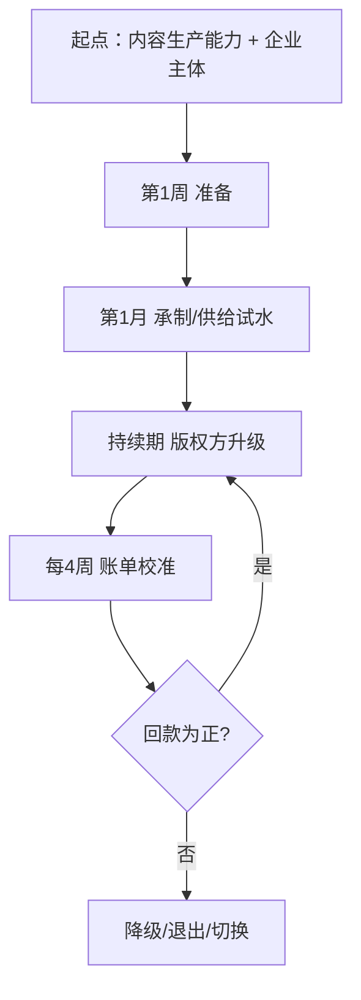

# PineDrama 自动变现工作指南：内容供给方分账变现 Playbook

> 本篇在既有 PineDrama 产品调研（[产品概览](00-overview.md) 至 [风险与展望](08-risks-and-outlook.md)）基础上，回答一个问题：**通过 PineDrama/TikTok 短剧生态实现自动变现，需要做哪些工作？**
>
> **性质声明**：本篇是路径设计（设计产物），**不是收益承诺**。所有收益数字均为平台/媒体公开口径转述，个人到手值受分账规则、内容表现与结算周期影响，凡无官方口径支撑处均标注「待验证」。撰写日 2026-10-09，规则与激励按期变动，执行时以当期官方页面为准。

## 1 三条核心洞察（为什么这样设计）

1. **分成池在涨，但个人到手仍不可预计算**——TikTok 短剧分账池逐月攀升（2026Q1 超 2400 万美元 [S-31] → 5 月 2100 万 [S-42] → 7 月 2900 万 [S-45] → 8 月破 3100 万 [S-34]），但官方**未公布统一分成比例**（[S-38] 的「非独家 70%/独家 80%」为第三方说法，未经官方证实）。战报的「破亿」是全平台分成池，与个人收益无直接换算关系。
2. **企业主体与「三流一致」是硬门槛，个人直接入驻不可行**——官方发布路径要求企业主体、供应商信息、付款账户三者一致（[S-49]），税务端进一步要求合同流/资金流/发票流相互印证（[S-44]）。冷启动者需先解决主体问题。
3. **AI 短剧承制存在「以量换价」窗口**——TikTok 曾以 4000–5000 元/分钟收购 AI 拟真人剧，「月万分钟计划」将承制单价降至 300–500 元/分钟（[S-48]，单源转引）。单价下降不等于收入下降，但**月万分钟计划要求单一供应商月交付 1 万分钟，个人/小团队产能通常不可达**，应以专项激励/小额承制试水为主。

## 2 角色化路径矩阵（3 类角色）

| 维度 | A · 内容供给方（**主路径**） | B · 广告投放方 | C · 生态服务方 |
|---|---|---|---|
| 适合人群 | 有内容生产能力、无渠道无粉丝、愿以承制/剧本切入再升级版权方的小团队 | 有投放预算、懂买量与 ROI 的团队（**不适合冷启动个人**） | 有 AI 制作/翻译/剪辑/数据分析技能的个人或小团队 |
| 核心路径 | 阶段 1：Drama Center 入驻 → AI 短剧承制/剧本授权试水；阶段 2：自有剧集上线分账 | 为短剧 App/小程序投放广告获取用户，以 IAP/IAA 回收 | 为内容方提供 AI 短剧制作、翻译配音、数据/代运营服务 |
| 日均投入 | 1.5–2 小时（设计估计，非平台口径） | 资金为主，时间次要 | 1–2 小时/项目制 |
| 收益区间 | 平台分账池口径（见 §4）；**个人到手待验证** | 无公开口径 → 待验证 | 服务定价无公开口径 → 待验证 |
| 主要风险 | 企业主体门槛 [S-49]、回款周期长 [S-44]、分成比例不公开 [S-38]、区域清单不公开 [S-47] | 资金沉没、买量成本无公开数据 | 需求不稳定、无平台官方保障 |

## 3 主路径详解：内容供给方分账变现

五要素：**起点条件 → 准入门槛 → 分阶段行动 → 预期收益区间 → 退出/切换条件**。

### 3.1 起点条件

1. 具备内容生产能力：能完成分钟级竖屏短剧的剧本、拍摄/剪辑或 AI 工具工作流（设计前提，用户画像）；
2. 可满足企业主体资质验证：自有营业执照/个体工商户，或通过既有主体合作——注意官方要求**企业主体、供应商、付款账户三者一致**（[S-49]），任何借用/挂靠安排均须确保合同、收款与税务主体一致，并自行评估合规风险（[S-44]）；
3. 每日可稳定投入 ≥1.5 小时（设计约束，非平台口径）；
4. **接受回款周期长**：官方发票审核约 15 天、付款随合同约定（[S-50]），税务端确认「分账金额往往滞后几个月才能确定」（[S-44]）——需预留 2–3 个月现金流缓冲；
5. 接受「收益待验证」：首 4 周以后台结算账单为唯一事实来源，不以战报池口径预期个人收益。

### 3.2 准入门槛

| 门槛项 | 口径 | 出处 | 核验状态 |
|---|---|---|---|
| 企业主体 | 企业主体、供应商信息、付款账户三者必须一致；企业验证是签署协议/上传内容/接收付款的前置条件 | [S-49]/[S-43] | 官方已核 |
| 发布路径 | 二选一：Mini Drama 小程序（H5，仅特定市场开放）或 Drama Center 企业账号直接发布 | [S-49]/[S-47] | 官方已核 |
| 内容合规 | 不允许色情、暴力、低创内容 | [S-45] | 媒体转引已核 |
| 分成比例 | 官方未公布统一分成比例 | [S-38]/[S-47] | 待验证 |
| 区域资质 | 官方未公布完整国家列表/审批时间线，需在自身账号内核实访问权限 | [S-47] | 行业媒体已核 |
| 个人入驻 | 个人独立入驻与结算未见官方明确承诺 | [S-43]/[S-49] | 待验证 |

### 3.3 分阶段行动清单（原子化：单一职责 × 可独立验证 × 验收标准）

#### 第 1 周：准备（主体 + 官方路径 + 内容方向）

| 编号 | 行动项 | 验收标准 |
|---|---|---|
| W1-1 | 通读官方帮助文档「如何发布短剧内容」与 Drama Center 官网（`tiktokdramacenter.com`，[S-40]/[S-42] 佐证），确认两条发布路径与适用市场（[S-49]） | 输出 1 页笔记：本账号适用路径、所需材料清单 |
| W1-2 | 企业主体准备：确认自有/可用的营业执照或个体工商户，备齐营业执照、法人身份证明、授权证明、地址证明（[S-43]）；若无可注册主体，评估既有主体合作方案 | 材料清单齐全并归档；替代方案须书面确认合同/收款/税务主体一致性（[S-49]/[S-44]） |
| W1-3 | 确定内容方向：在「真人翻译剧 / 本土剧 / AI 短剧」三赛道中选择 1 个主攻方向（三条赛道均有分账战报，[S-42]/[S-45]） | 方向选定并记录理由（AI 短剧适合低资金、可远程交付） |
| W1-4 | 建立「规则与激励跟踪表」：收藏 Drama Center 官网、TikTok for Business 帮助页与官方战报媒体页 | 跟踪表存在且含至少 4 个跟踪 URL |
| W1-5 | 现金流缓冲检查：确认可覆盖 2–3 个月无回款的运营成本（[S-44] 回款滞后） | 缓冲金额记录在案；不足则调整投入强度 |

#### 第 1 月：冷启动切入（承制/供给试水）

| 编号 | 行动项 | 验收标准 |
|---|---|---|
| M1-1 | 完成 Drama Center 入驻：注册登录 → 创建机构 → 企业主体资质验证 → 提交供应商信息与收款账户 → 签署合同（[S-49]） | 后台可见「已签约」状态或同等反馈 |
| M1-2 | 建立内容管线：用 AI 工具搭建「剧本 → 分镜 → 生成 → 剪辑 → 配音」工作流，产出 1 条 1–3 分钟样片 | 样片产出并自检合规（[S-45]）；记录单集耗时与成本 |
| M1-3 | 关注承制/激励入口：跟踪三大专项激励（AI 爆款短剧激励、优质剧本授权激励、AI 短剧承制激励，[S-42]）与 AI 承制采购动态（[S-48]）；**专项激励的申请入口与条件未见官方公开细则** → 在 Drama Center 后台/官方公告中查找，有公开入口则提交 1 次申请或报价 | 跟踪记录含申请/报价动作与平台反馈；若入口未公开，记录「入口未公开/待验证」 |
| M1-4 | 内容合规自检：对照「不允许色情、暴力、低创内容」建立发布前自检清单（[S-45]） | 自检清单存在并用于样片 |
| M1-5 | 建立到账记录表：记录供应商资料、合同编号与可查到的结算账单页（[S-50]） | 表格存在；首月末至少 1 条账单查询记录 |

#### 持续期：版权方升级与复利

| 编号 | 行动项 | 验收标准 |
|---|---|---|
| O-1 | 产能复利：迭代 AI 工作流，把单集制作成本降至可持续水平，保持每月稳定供给 | 月产能 ≥ 上月 80%；单集成本环比下降或持平 |
| O-2 | 版权方升级评估：当承制/激励回款稳定后，评估以自有版权剧集上线 Drama Center 分账（广告分成 + 付费解锁，[S-40]） | 每季度 1 份评估记录（含预期成本/回款/风险） |
| O-3 | 激励跟踪：每月检查专项激励（[S-42]）与承制计划（[S-48]）是否更新 | 月度跟踪记录（激励名/入口/动作/反馈） |
| O-4 | 规则复核：每期重读官方页面规则并存档快照（区域/审批时间线可能变化，[S-47]） | 每期 1 份规则快照 |
| O-5 | 收益复盘：每 4 周汇总后台结算账单，对照 §5 阈值决策继续/降级/退出 | 4 周复盘表存在且含决策结论 |
| O-6 | 税务合规：按「合同流/资金流/发票流」三流印证要求建立收入分类辅助台账（[S-44]） | 台账存在且与合同/回款/发票可核对 |

### 3.4 预期收益区间（口径转述，非承诺）

- **平台分账池（全平台口径，非个人收益）**：2026Q1 超 2400 万美元（[S-31]）；5 月 2100 万美元、环比 +40%（[S-42]）；7 月 2900 万美元、1–7 月累计破 1.1 亿美元（[S-45]）；8 月破 3100 万美元（[S-34]）。
- **单家版权方上限（战报口径，上界事件）**：5 月单家版权方最高 180 万美元（[S-42]）；7 月 3 家版权方单月超 150 万美元（[S-45]）。**这是头部上界，不是期望收益。**
- **承制价（AI 短剧）**：4000–5000 元/分钟收购价；「月万分钟计划」300–500 元/分钟（[S-48]，单源转引）。
- **个人到手**：= 合同约定分成比例 × 实际播放/解锁产生的收益。**分成比例官方未公开（[S-38]）→ 待验证**；以后台结算账单为准（[S-50]）。

> **防画饼提示**：「最高 100 倍激励系数」（[S-40]）是平台加权机制，**不是现金倍数**，正文不作收益换算；「非独家 70%/独家 80%」未经官方证实（[S-38]），不写入主路径预期；「月万分钟计划」面向规模化供应商（[S-48]），个人产能通常不可达，承制试水以专项激励窗口为主。

## 4 收益/门槛声明 → 信源映射

| 本页声明 | 出处 | 核验状态 |
|---|---|---|
| Drama Center 一站式入口、广告分成 + 付费解锁、最高 100 倍激励系数 | [S-40]/[S-29] | 官方已核 |
| 两条官方发布路径 | [S-49]/[S-47] | 官方已核 |
| 企业主体/供应商/付款账户三者一致 | [S-49]/[S-43] | 官方已核 |
| Q1 分成超 2400 万美元、AI 短剧破 200 万 | [S-31]/[S-48] | 三源转引已核 |
| 5 月分账 2100 万美元、单家最高 180 万 | [S-42] | 单源转引 |
| 7 月 2900 万美元、1–7 月累计 1.1 亿美元、3 家超 150 万 | [S-45] | 媒体转引已核 |
| 8 月 3100 万美元、270+ 版权方月收入翻倍 | [S-34] | 媒体转引已核 |
| 统一分成比例未公开；「70%/80%」待验证 | [S-38]/[S-47] | 待验证 |
| 发票最低 $100、审核约 15 天、付款随合同 | [S-50] | 官方已核 |
| 结算周期长、分账滞后数月、三流印证 | [S-44] | 官方已核（P0 监管源） |
| AI 承制 4000–5000 元/分钟、月万分钟 300–500 元/分钟 | [S-48] | 单源转引 |
| 官方未公布国家列表/审批时间线 | [S-47] | 行业媒体已核 |
| 内容合规：禁色情/暴力/低创 | [S-45] | 媒体转引已核 |
| 三大专项激励 | [S-42] | 媒体转引已核 |
| 个人独立入驻未见官方承诺 | [S-43]/[S-49] | 待验证 |

## 5 退出/切换条件

**角色 A（内容供给方主路径）**：

| 类型 | 触发条件 | 动作 |
|---|---|---|
| 降级 | 连续 4 周执行后，后台结算账单连续 2 个账单周期为零或低于覆盖成本 | 降至维持性供给（仅保留内容管线），暂停新投入 |
| 退出 | 连续 4 个账单周期无任何分账/承制回款；或规则变动致门槛超出能力（如区域关闭、企业资质要求提高） | 退出供给路径；已上线剧集保留 |
| 切换 | ① 回款连续 3 期为正 → 评估升级版权方（O-2）；② 承制需求消失而自身有技能溢价 → 切换至生态服务方 | 资源向版权方升级或服务方倾斜 |

**角色 B（广告投放方）**：投放 ROI 无法回收（无公开口径，以自身数据为准）→ 停止投放；素材能力强的团队可切换为内容供给方。

**角色 C（生态服务方）**：连续 2 个月无稳定需求 → 缩减投入；具备内容生产能力 → 切换为内容供给方。

## 6 一页结论

> PineDrama/TikTok 短剧生态的变现入口对「无渠道、无粉丝、每日 ≤2 小时」的个人是**真实存在但门槛前置**的：企业主体资质是硬门槛（[S-49]），分成比例官方不公开（[S-38]），回款以月计（[S-44]/[S-50]）。可行的主路径不是「赌一部爆款」，而是**以 AI 短剧承制/剧本授权等低资金供给方式先验证回款，再评估版权方升级**（[S-42]/[S-48]）。所有收益预期以「后台结算账单」为唯一事实来源，战报池口径仅供行业坐标参考。

## 7 可迁移模式（G3 萃取）

**模式名称**：供给切入 · 版权升级（平台型内容生态的冷启动变现模式）

- **触发场景**：适用于有内容生产能力、无渠道无粉丝、每日 ≤2 小时的个人/小团队，希望在平台型内容生态（如 TikTok 短剧、红果/抖音短剧、YouTube 分账等）获取第一笔可验证收益。**不适用于**无生产能力、或期望 30 天内快速回款、或无法满足平台主体资质要求的参与者。
- **核心步骤**：① 解决平台资质前置条件（企业主体/收款账户一致性）；② 以低资金、可远程交付的「供给」形态切入（承制/授权/代工）；③ 建立可复用内容管线降低边际成本；④ 以后台账单为唯一事实来源定期校准；⑤ 回款稳定后评估升级为「版权/资产」形态。
- **反模式**：
  1. 以平台战报池口径预期个人收益（池 ≠ 个人）；
  2. 未解决主体资质就投入大量内容制作（资质是前置条件）；
  3. 未预留 2–3 个月现金流缓冲就全力投入（回款周期长）；
  4. 死等未公开的激励入口而不做替代供给（入口未公开应标「待验证」并继续试水）。
- **迁移验证**：该模式在知乎创作激励、YouTube Partner Program 等平台生态同样成立——先以低门槛供给验证回款机制，再升级资产型投入。此为跨场景推演（设计判断，非事实声明），知乎变现路径在本仓库另有独立调研束（`.trae/specs/create-zhihu-monetization-okf-wiki/`），不在本 bundle 范围内。

## 相关概念

- [产品概览](00-overview.md)
- [免费 IAA 商业模式](03-iaa-business-model.md)
- [字节战略：红果复刻与双轨漏斗](06-bytedance-strategy.md)
- [风险与展望](08-risks-and-outlook.md)
- [信源登记](../references/00-sources.md)
- [数据口径与冲突说明](../references/01-data-caliber.md)