# 复盘报告：玄境（Xuanspace）全面复盘

> 复盘日期：2026-10-10 | 项目周期：2026-07-24 ~ 2026-10-10 | 提交总数：360 次 | 方法论：七概念（R→I→E→V→A→C）

> 本报告为 xuanspace 第二次全量历史全面复盘，覆盖全部 **360 次提交**，并重点分析 2026-08-26 之后的 **38 次增量**。它与三份既有复盘形成对照关系：初始化阶段 [retrospective-xuanspace-mono-repo-20260724](../retrospective-xuanspace-mono-repo-20260724/README.md)（2026-07-20 ~ 07-24，20 个任务）、阶段一里程碑 [2026-08-25-xuanspace-milestone-retro](../../2026-08-25-xuanspace-milestone-retro.md)（2026-07-24 ~ 08-19，314 次提交）、首次全量 [retrospective-xuanspace-comprehensive-20260826](../retrospective-xuanspace-comprehensive-20260826/README.md)（2026-07-24 ~ 08-25，322 次提交）。本报告在继承既有结论的基础上，做增量校正与结构性重判。

## S1. 事实收集

### 全量规模与节奏

| 维度 | 数值 | 来源 |
|------|------|------|
| 提交总数 | 360 次 | F-001 |
| 提交日期范围 | 2026-07-24 ~ 2026-10-10 | F-002 |
| 活跃日期数 | 25 天 | F-006 |
| 峰值日期 | 2026-07-31（69 次） | F-007 |
| 次高峰日期 | 08-04（41）、08-05（37）、07-28（32）、07-24（23）、07-30（21）、08-03（21）、08-01（15） | F-008 |
| 月度分布 | 2026-07 = 168、2026-08 = 154、2026-09 = 33、2026-10 = 5 | F-009 |
| 增量占比 | 38 / 360 = 10.56% | F-010 |
| 历史锚点 | 截至 08-19 = 314 次、截至 08-25 = 322 次 | F-011 |
| 作者分布 | Trae Agent 253、xinetzone 107（合计 360） | F-012 |

### 提交类型与 Scope 分布

全量口径 type 分布（F-013）：

| 类型 | 数量 | | 类型 | 数量 |
|------|------|---|------|------|
| feat | 93 | | refactor | 15 |
| test | 63 | | build | 9 |
| fix | 62 | | perf | 9 |
| docs | 58 | | ci | 5 |
| chore | 43 | | merge | 1 |

- 另有 2 条 subject 不符合 `type(scope):` 前缀（1 条 `Merge branch ...`、1 条 `test+ci(caffe-ffi): ...`，F-013）
- 增量口径 type 分布：docs 10、feat 9、build 7、chore 6、refactor 2、test 2、fix 1、merge 1（F-014）
- 增量 build 占比 18.4%（7/38），全量 build 占比 2.5%（9/360），占比抬升约 7 倍（F-016）
- 增量口径 scope 分布：compose 13、xuan-compose 7、submodule 4、doctor 3、submodules 2、conf 1、doc 1、okf 1、readme 1、root 1、scripts 1、templates 1、xs 1、xuan-core 1（F-015）；xuan-compose 系（compose + xuan-compose）合计 20/38
- **口径说明**：本次事实采集未包含全量 scope 分布（`facts.md` 仅有增量 scope，F-015），故本表不列全量 scope，避免臆造；全量 scope 对照见既有 [20260826 报告](../retrospective-xuanspace-comprehensive-20260826/README.md)。

### 增量 38 条主题聚类（2026-08-26 ~ 2026-10-10）

来源：F-017 ~ F-054 逐条按 subject 归类计数（F-055 ~ F-061）。

| 主题 | 提交数 | 代表 commit | 编号 |
|------|:------:|-------------|------|
| xuan-compose 分层重构交付（脚手架 + 七层迁入 + T9/T10/T11 + 验收/总结报告） | 14 | 7edfda0（脚手架/GPL 基线）、9d91a3e（CLI 层）、43f7812（T9 全量对等门禁） | F-055 |
| 纯 Python 打包门禁双轨化（`wheel.cmake=false`） | 7 | 4b4c082（双轨化）、f293ed6（枢纽包） | F-056 |
| 子模块指针与上游同步 | 6 | 89eedf5（新增 libs/mystx）、401d51d（tvm-ffi） | F-057 |
| 2026-10-10 xuan-compose 对等文档原子化与上游怪癖分级 | 5 | e4b2a74（原子化十文件）、88e3ea7（怪癖分级口径） | F-058 |
| 文档与配置治理（`doc/` 目录改名、conf 并行守卫、README 徽章） | 3 | 4d4a6cd（docs/→doc/）、e893b25（fail-fast 守卫） | F-059 |
| doctor 子系统（子模块指针检查 + Sphinx 路径修复） | 3 | ef18da7（子模块指针检查） | F-060 |
| **合计核对** | **38** | 14 + 7 + 6 + 5 + 3 + 3 | F-061 |

增量每日分布：08-26 之后 38 条集中于 8 个活跃日期——09-03（3）、09-04（4）、09-15（8）、09-16（14）、09-21（1）、09-22（1）、09-23（2）、10-10（5）（F-062）；单日峰值 09-16（14 次）、次高 09-15（8 次）（F-063）；区间内 08-26~09-02、09-05~09-14、09-17~09-20、09-24~10-09 四段无提交（F-064）。

### 关键里程碑提交

| 里程碑 | 哈希 | 说明 | 编号 |
|--------|------|------|------|
| 1 | 7edfda0 | 2026-09-15 新增 xuan-compose 包脚手架，确立 GPL-2.0 对等重构基线 | F-065 |
| 2 | 9d91a3e | 2026-09-15 迁入 CLI 层 parser/main 与 `python -m` 入口（分层迁入链末环） | F-066 |
| 3 | 43f7812 | 2026-09-16 T9 全量对等门禁——argparse 快照零差异与覆盖率补齐 | F-067 |
| 4 | 88e3ea7 | 2026-10-10 建立上游怪癖固化级别分级口径 | F-068 |
| 5 | 587da1c | 2026-10-10 加固 create_secrets 报错全文断言（**HEAD**） | F-069 |

### 仓库状态与版本

| 维度 | 事实 | 编号 |
|------|------|------|
| HEAD | `587da1c`（2026-10-10 16:14:39 +0800，分支 main） | F-004、F-005 |
| 子模块 | `.gitmodules` 声明 4 个（vendor/tvm-ffi、libs/tvm-book、vendor/caffe、libs/mystx），**全部已初始化且指针无漂移** | F-074、F-075 |
| 包数量 | 全仓 `pyproject.toml` 共 20 个（含 vendor 子系统与子模块内） | F-096 |
| 构建后端 | 根与第一方包统一 scikit-build-core（`scikit_build_core.build`，`wheel.cmake=false`） | F-076、F-077 |
| Python 版本 | 根与多数 libs 声明 `>=3.14.6`；xuan-compose 声明 `>=3.14`（不一致） | F-076、F-082、F-085 |
| 目录结构 | `libs/` 8 条目（含子模块 mystx/tvm-book）；`apps/` 与 `attic/` 仅为 `.gitkeep` + README | F-090、F-089、F-093 |
| 测试规模 | 顶层 5 个 `test_*.py`；libs 合计 172（caffe-ffi 104、xuan-compose 53 等）；tools/okf 19；全仓含 vendor 277、排除 vendor 199 | F-117、F-118、F-119、F-120 |
| 版本声明 | 根 CHANGELOG `0.1.0`（2026-07-23）、caffe-ffi `1.2.0`、xuan-compose `0.1.0`（独立于上游） | F-078、F-083、F-112 |
| 工作区 | **双时点标注**：采集时点 13 行未提交改动（F-070）/ 复核时点 20 行（19 ` M` + 1 `??`，F-128），全部位于 `libs/xuan-compose/`，归因并行会话在途工作（F-129） | F-070、F-128 |

完整事实清单（F-001 ~ F-129）见 [insight-extraction.md](insight-extraction.md) 附录。

## S2. 过程分析（时间线聚类）

```mermaid
flowchart LR
    subgraph 初始化期[初始化期 07-20~07-24]
        A[仓库创建<br/>xs CLI v0.1.0]
    end
    subgraph 爆发期[核心爆发期 07-24~08-06]
        B[scikit-build-core 统一<br/>59420ac]
        C[COW Phase 2<br/>814a0ab]
        D[Backward 梯度<br/>f763247]
        E[端到端测试<br/>f5ac091]
        F[ResNet50 2.93x<br/>e321ecd]
    end
    subgraph 空窗期[空窗期 08-07~08-17]
        G[低活跃]
    end
    subgraph 收尾期[收尾期 08-18~08-25]
        H[12+1+8 次提交<br/>修复与收尾]
    end
    subgraph 脉冲期[增量脉冲期 08-26~10-10]
        I[xuan-compose 迁入 14<br/>7edfda0]
        J[纯 Python 打包双轨化 7<br/>4b4c082]
        K[子模块同步 6<br/>89eedf5]
        L[怪癖分级+文档原子化 5<br/>88e3ea7]
        M[doctor 子系统 3<br/>ef18da7]
    end
    A --> B --> C --> D --> E --> F --> G --> H --> I --> J --> K --> L --> M
```

- **初始化期**：2026-07-20 ~ 07-24（见先例报告），完成仓库骨架与 xs CLI v0.1.0
- **核心爆发期**：2026-07-24 ~ 08-06（全量 93.2% 提交落于此段，见 [20260826 报告](../retrospective-xuanspace-comprehensive-20260826/README.md)），主线为构建统一、COW 内存机制、Backward 反向传播、端到端测试、性能优化五大工程线
- **空窗期**：2026-08-07 ~ 08-17，低活跃连续
- **收尾期**：2026-08-18 ~ 08-25，以修复与收尾为主，全量至此累计 322 次（F-011）
- **增量脉冲期**：2026-08-26 ~ 10-10，仅 38 次（F-010），且不再"单峰大冲刺"而是散为 6 个任务事件（F-055 ~ F-061），事件之间四段零提交（F-064）

### 四条主题线索（增量期）

1. **结构迁移线**：xuan-compose 整包迁入 monorepo 并分层重构，14 次提交完成七层迁入 + T9/T10/T11 门禁（F-055），对等目标锁定上游 v1.6.0（F-112）
2. **依赖锁线**：4 个子模块全部初始化、指针无漂移（F-075），同期建立上游怪癖 L0-L3 分级口径（F-058、F-114）并对齐 142 个上游公开符号（F-113，自报口径）
3. **打包治理线**：纯 Python 包构建门禁双轨化，7 条提交把 `wheel.cmake=false` 铺到 xuan-compose/xuan-core/xs/okf/root/templates（F-056）
4. **自动核验线**：doctor 子系统从"无"到"子模块指针一致性检查 + Sphinx 路径检查"（F-060），为结构一致性提供可量化复现手段

## S3. 洞察提炼

四条洞察的完整四元组（现象 / 5-Whys 根因 / 影响 / 建议）见 [insight-extraction.md](insight-extraction.md) 第一节，摘要如下：

| # | 洞察主题 | 一句话陈述 |
|---|---------|-----------|
| I-1 | 增量事件脉冲 | 38 次增量散为 6 个离散任务事件（F-055 ~ F-061）而非匀速推进，与全量"单峰冲刺"同构，根因指向协作模型缺少常驻待办池（standing backlog） |
| I-2 | 迁入即治理 | 增量期 feat 让位、docs 10 次反超（F-014），build 占比抬升约 7 倍（F-016），揭示"外部单体迁入统一仓库 → 私有约定升级为公共约束"的治理规律 |
| I-3 | 上游行为分级锁定 | L0-L3 怪癖分级固化 + 怪癖台账 + 对等门禁（F-113 ~ F-115），把外部依赖从"信任外部"升级为"对外部行为建模并分级锁定" |
| I-4 | 分布式增量 vs 集中式约束 | `libs/` 6→8、4 子模块全部初始化（F-075、F-090）与 `requires-python` 不一致（F-082、F-085）并存，暴露结构扩张与全局一致性债的结构性张力 |

## S4. 行动项（G4 原子化）

8 条行动项的完整定义（描述 / 优先级 / Owner / 触发条件 / 验收标准 / 来源）见 [actionable-items.md](actionable-items.md)，摘要如下：

| ID | 行动项 | 优先级 | Owner |
|----|--------|:------:|-------|
| ACT-01 | 常驻待办池 + spec 会话后继可执行项登记 | 高 | 项目维护者 |
| ACT-02 | 迁入即治理检查单纳入 `xs doctor` 自动核验 | 高 | 项目维护者 |
| ACT-03 | `requires-python` 一致性对齐（20 个 pyproject） | 中 | 项目维护者 |
| ACT-04 | 上游同步强制"怪癖台账 diff 复核"门禁 | 中 | 项目维护者 |
| ACT-05 | 怪癖 L0-L3 分级上升为仓库级规范 | 中 | 项目维护者 |
| ACT-06 | 工作区快照双时点标注纪律 | 中 | 复盘/报告作者 |
| ACT-07 | F-113 自报值的证据强度治理 | 中 | 复盘/报告作者 |
| ACT-08 | `apps/`、`attic/` 空壳目录状态标注 | 低 | 项目维护者 |

## 附：质量门记录

| 质量门 | 结果 | 说明 |
|--------|:----:|------|
| G1 事实无因果词 | PASS | 129 条事实（F-001 ~ F-129）；因果词检索命中 1 处（F-048 行内逐字引述 commit subject），属引述豁免；抽查 12 条回溯命中率 12/12 = 100% |
| G2 洞察四元组 | PASS | 4 条洞察（I-1 ~ I-4），四元组完整，各条引用 F 编号 11/11/8/12 个（均 ≥2）；TR-2.2 深度自评 I-1=5、I-2=4、I-3=5、I-4=5，全部 ≥4 |
| G3 模式可迁移 | PASS | 候选 B「迁移窗口的结构约定对齐法」四要素齐备，可迁移至组织整合/数仓多源接入/前端 monorepo 三场景，已[新建 L1 入库](../../../patterns/methodology-patterns/governance-strategy/migration-triggered-convention-alignment.md)；候选 A 经去重裁决并入既有 [behavior-characterization-freeze](../../../patterns/methodology-patterns/governance-strategy/behavior-characterization-freeze.md)（限 3 条） |
| V 对抗审查 | PASS | 四视角 7 条意见（V-1 ~ V-7），采纳 5 条（修正痕迹落于 E 阶段 §2.1/§1.2/§1.4×2/§4.1），不采纳 2 条各附理由 |
| G4 行动项原子化 | PASS | 8 条行动项，均单一职责、可独立验证、含优先级/Owner/触发条件/验收标准；AC-8 自评最低 4 分、整体 ≥4 |

## 附录：限定说明与证据强度

本节落实 V 阶段采纳项，对报告中三处结论做显式限定，避免过度断言。

1. **I-1 根因为"一种解释"而非"必然产物"**（采纳 V-6）：I-1 将增量"多段脉冲"节奏归因于"协作模型缺少 standing backlog"，其核心证据（全量峰值 F-007 与增量峰值 F-063 的同构性、全量 89.4% 提交集中于 08-25 前，F-011）**支持**"同一协作模型贯穿两期"的解释，但**无法排除**竞争假设——项目可能已进入维护期、可执行工作量本身下降，且 `facts.md` 未采集"可执行工作量"类事实。因此该结论**不得表述为必然产物**，"建立常驻待办池"的建议须在竞争假设被证伪后才具强必要性。
2. **F-113 为项目自报口径、未经重跑验证**（采纳 V-5）：xuan-compose 对等门禁的「484 ≥ 478」「skip=0」「覆盖率整体 91%」「142 个上游公开符号 100% 映射」均出自 `libs/xuan-compose/CHANGELOG.md`（F-113）**项目自述**，本复盘全程只读、未重跑任何构建或测试，故这些数值**仅作规模量级参考**，不得作为对等性/一致性的证据；一致性判定须以仓库文件实体（各 `pyproject.toml` 实读，如 F-082、F-096）为准。
3. **工作区事实采双时点标注、不作确定性结论**（采纳 V-6 相关纪律）：`facts.md` 中 F-070（采集时点 13 行未提交改动）与 F-128（复核时点 20 行：19 ` M` + 1 `??`）数值不一致，表明 `projects/xuanspace` 工作区处于**并行会话持续写入状态**；本报告凡涉及工作区一律采"采集时点 / 复核时点"双时点标注，**不将任一数值当作当前状态的确定性结论**。该等改动全部归因于并行会话（`.trae/specs/sync-upstream-delta/`，F-110、F-129）的在途工作，本复盘对 `projects/xuanspace` 全程只读、未写入任何文件。